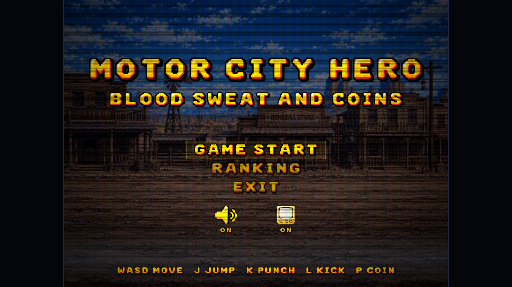
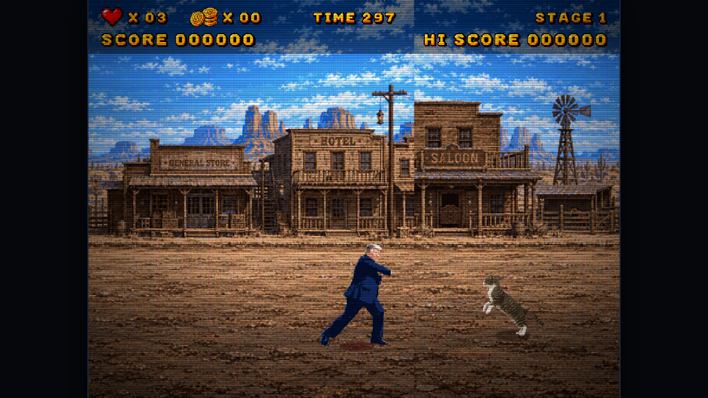

# 모터시티 히어로 (Motor City Hero)

고전 오락실 스타일 횡스크롤 배틀 액션. 1인용.

## 플레이

- **브라우저에서 바로**: https://parkrye.github.io/WebProject_MotorCityHero/ (PC · 모바일)
- **내려받아 오프라인으로 (Windows)**: [Releases](../../releases)에서 `MotorCityHero-<버전>-windows.zip`을 받아 압축을 풀고 `play.bat` 실행 (또는 `game/index.html`을 바로 열어도 됨)

배포판에는 온라인 랭킹 서버가 없어서 랭킹 기록은 남지 않는다.

## 조작

| 동작 | 키보드 | 터치 |
|---|---|---|
| 이동 | `W` `A` `S` `D` | 왼쪽 스틱 |
| 점프 | `J` | 빨간 버튼 |
| 펀치 | `K` | 노란 버튼 |
| 킥 | `L` | 초록 버튼 |
| 코인 투입 | `P` | 구석의 동전 |

- 메뉴의 확인키는 `J` `K` `L` 아무거나
- 공중에서 낸 공격은 점프 펀치 · 점프 킥으로 나간다. 뜨는 순간 0.3초 무적
- 터치 기기에서는 화면에 오락기식 조이패드가 뜬다

## 흐름

스테이지마다 5분. 60초가 지나면 최종 보스가 등장하고, 보스를 쓰러뜨리면 다음 스테이지로. 생명이 다하거나 시간이 끝나면 코인으로 컨티뉴.

## 문의

버그 · 제안은 [Issues](../../issues)에.
